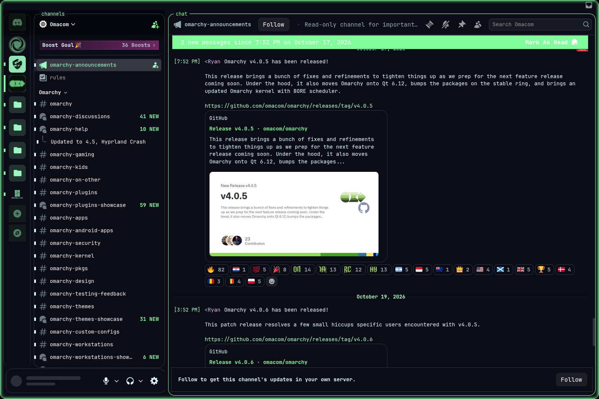
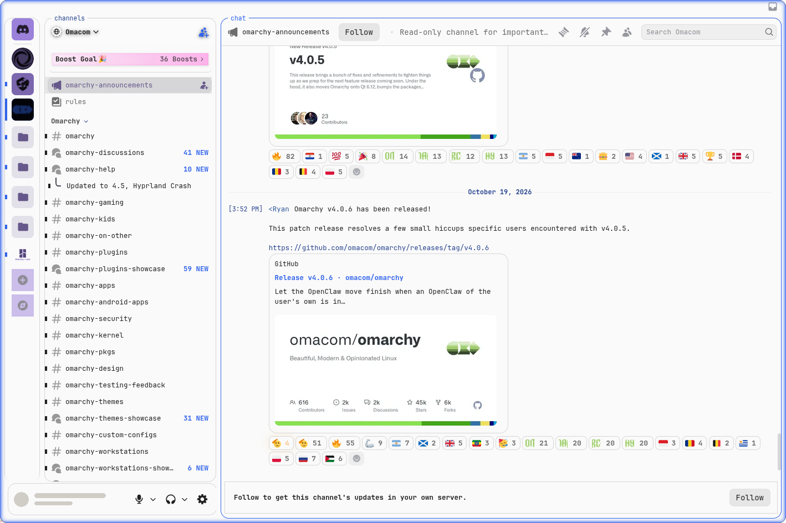

# Omarchy theme for Vesktop

A [Vesktop](https://vesktop.dev) theme that follows your [Omarchy](https://omarchy.org)
desktop. Switch your Omarchy theme and Vesktop recolors live, with no restart.





It restyles the app as a terminal session:

- Rounded panes with titles in their borders, and the active pane in your accent
- Small monospace text, with IRC-style messages like `[18:02] <name> message`
  (best with Discord's Compact message display)
- Server icons tinted with your theme's colors, and clean folder tiles
- Corners that match your Hyprland `rounding`, and your Omarchy font
- Promo banners, Nitro buttons and server banners hidden

This is an unofficial community theme. It isn't affiliated with or endorsed by
Discord, Vencord or Omarchy.

## Before you use it

Vesktop is a modified Discord client, which is against Discord's Terms of Service.
Bans for this are uncommon as far as anyone can tell, but they're possible, so
use it at your own risk.

The theme hides parts of the interface using Discord's internal names, so a
Discord update can break parts of it.

## Install

You need Omarchy, `jq`, and Vesktop (`yay -S vesktop-bin`). Start Vesktop once so
it creates its settings, then:

```bash
git clone https://github.com/HeyitsTayters/omarchy-vesktop-theme.git
cd omarchy-vesktop-theme
./install.sh
```

The installer re-applies your current Omarchy theme to generate the CSS.

| Option | What it adds |
|---|---|
| `--bar-icon` | A bar icon that opens or focuses Vesktop, dimmed when it isn't open |
| `--glow` | Sets Hyprland's window glow to your theme's accent on every theme change. Edits `hyprland.lua` |
| `--no-apply` | Skips re-applying your theme |

Remove it with `./uninstall.sh`.

## Tips

- Set **Settings → Appearance → Message Display** to Compact.
- The message box has no emoji, GIF or sticker buttons. Press Enter to send and
  type `:name:` for emoji.

Open Vesktop from a keybinding in `~/.config/hypr/bindings.lua`:

```lua
o.bind("SUPER + ALT + D", "Discord", "omarchy-launch-or-focus vesktop")
```

## How it works

`themed/vesktop.css.tpl` is an Omarchy template, so Omarchy fills in the colors on
every theme change. `hooks/vesktop-theme.sh` then adds your font and rounding and
copies the result to Vesktop's themes folder, which Vesktop reloads live.

## Known limits

- Tuned mainly on dark themes. Lupine is the only light theme tested.
- Settings pages keep larger text.
- Rows in long lists stay tall, because Discord positions them with fixed heights.
- Colors come from each theme's roles, so some themes suit it better than others.

## License

[MIT](LICENSE)
